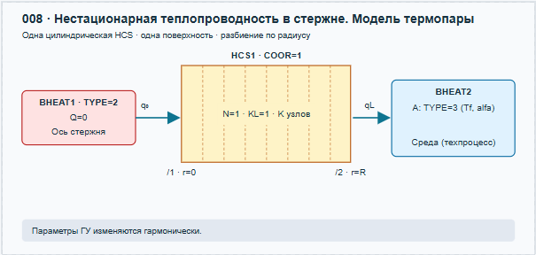
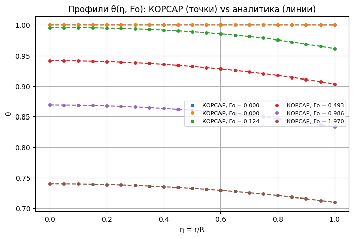
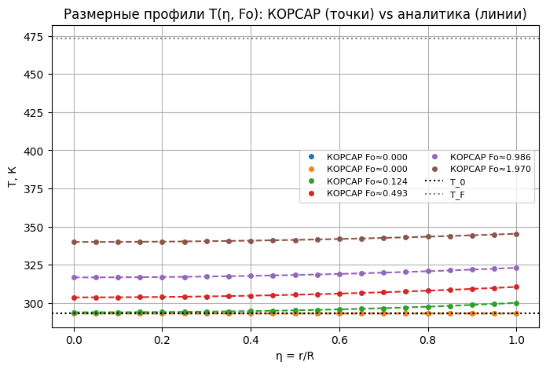
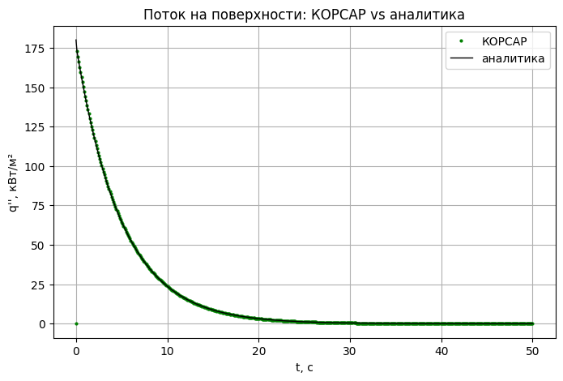
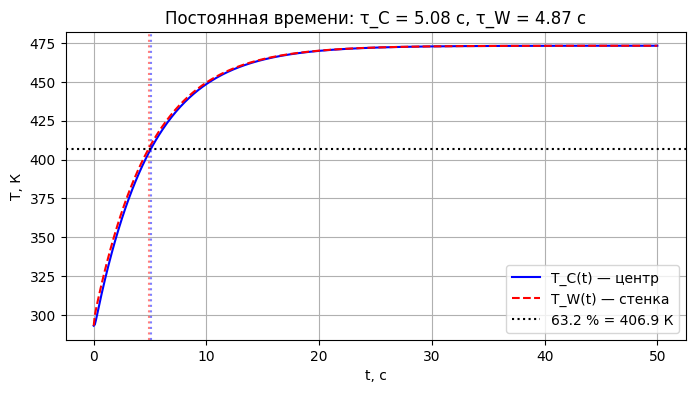
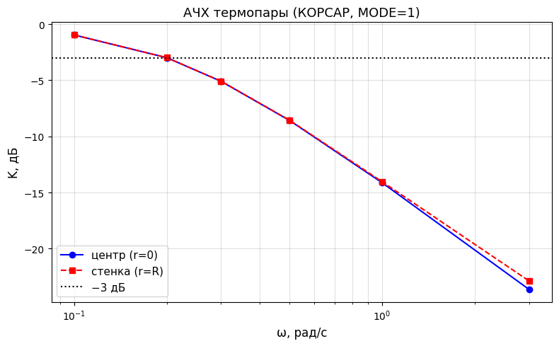
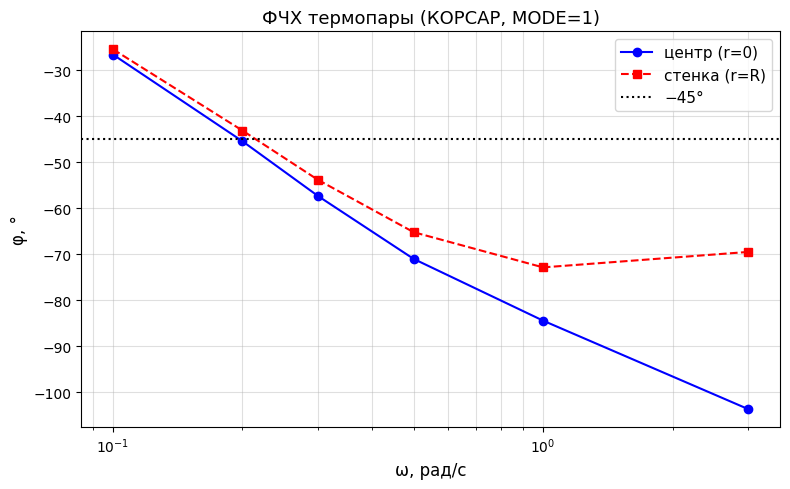
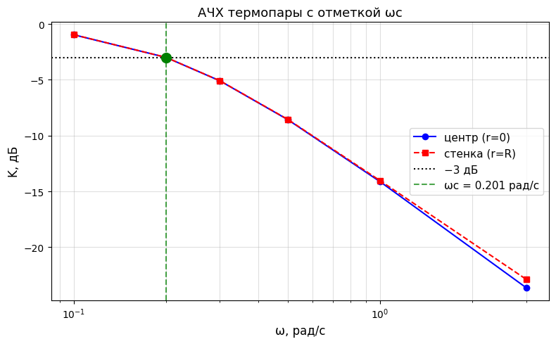

# Лабораторная работа №8. Нестационарная теплопроводность в полнотелом стержне. Модель термопары

## 1. Цель работы

Собрать в КОРСАР расчетную схему для исследования нестационарного теплового режима полнотелого стержня, моделирующего цилиндрическую термопару. Получить температурные профили для скачка температуры (аналитические и численные) по радиусу стержня во времени, сделать оценку постоянной времени термопары. По изменению гармонического сигнала построить АЧХ термопары, вычислить частоту среза по уровню 3 дБ.

### Навыки, приобретаемые по результатам выполнения работы

- Расчет цилиндрической HCS в нестационарном тепловом режиме
- Верификация получаемого численного решения
- Определение пригодности термопары для измерения быстропротекающих тепловых процессов

## 2. Описание постановки задачи

### 2.1. Два варианта граничных условий

Рассматривается бесконечный по длине стержень диаметра $D$. Координата $r$ отсчитывается от оси стержня: $0\le r\le R=\frac{D}{2}$. Материал однородный, свойства постоянны, внутренние источники и фазовые переходы отсутствуют. В нулевой момент времени температура всей стенки равна $T_0$. На наружной поверхности стержня заданы ГУ 3 рода (теплообмен с текучей средой).

Вариант нодализации представлен на [рисунке 1](#fig-nodal).

*[Рисунок 1 — Моедель термопары: полнотелый цилиндрический стержень](./pic/image.png)*

### 2.2. Исходные данные

| Параметр | Значение |
|---|---:|
| Диаметр $D$ | 0.005 м |
| Теплопроводность $\lambda$ | 30 Вт/(м·К) |
| Плотность $\rho$ | 7800 кг/м³ |
| Удельная теплоемкость $c$ | 500 Дж/(кг·К) |
| Начальная температура $T_0$ | 20 °C = 293.15 К |
| Температура термометрируемой среды | 200 °C = 473.15 К |

### 2.3. Математическая модель и аналитическое решение

Для нахождения аналитического решения может быть взята задача №43 [\[2\]](#ref-pehovich), для которой приведены безразмерные решения для температурного поля и теплового потока на наружной поверхности цилиндра.

### 2.4. План расчетов и исследование сходимости

1. Рассчитать профили $\theta(\eta=r/R,Fo)$, в контрольных координатах, поток тепла на поверхности теплоотдачи аналитическим методом и с использованием кода КОРСАР при задании температурного скачка в граничном условии. Т.к. аналитическое решение представлено в виде бесконечного ряда предварительно оценить конечную сумму членов, достаточную для получения решения с заданной точностью (не хуже $\varepsilon_{\theta}=10^{-5}$). 
2. Найти при помощи расчетов в коде КОРСАР постоянную времени, АЧХ и ФЧХ термопары любым методом, например: 
   - задавая гармоническое граничное условие с различной частотой и измеряя отклик на оси термопары;  
   - при помощи аналитического сигнала.
3. Провести анализ сходимости по шагу разбиения и по временному шагу

## 3. Требуемые результаты

- Размерные и безразмерные профили температуры в заданных точках.
- Плотность потока, Вт/м², на границе задания источника тепла; проверка стационарных режимов.
- Сравнение расчета по КОРСАР с аналитическими зависимостями.
- АЧХ и ФЧХ термопары, оценка частоты среза
- Скрипты обработки данных, получения аналитических решений и расчета отклонения численного решения по КОРСАР от аналитического.
- Сводная таблица сходимости по разбиению и временному шагу.

## 4. Ход выполнения работы  

### 4.1. Построение нодализационной схемы  

Схема задачи реализована элементами:
- HCS1 (Теплопроводящая конструкция) — центральный элемент, моделирующий цилиндрический стержень.
- COOR=1 — задает цилиндрическую геометрию (ось — это внутренняя поверхность, /1 при r=0, внешняя — /2 при r=R).
- N=1 — одна расчетная ячейка по длине.
- KL=1 — один слой материала по толщине.
- K узлов — количество расчетных узлов по радиусу (согласно схеме).
- BHEAT1 (Заданное граничное условие по теплообмену) — элемент, задающий граничное условие на оси стержня (/1, r=0).
- TYPE=2 — граничное условие II рода (заданный тепловой поток).
- Q=0 — нулевой тепловой поток (адиабатическая ось или условие симметрии).
- BHEAT2 (Заданное граничное условие по теплообмену) — элемент, задающий условие на внешней поверхности стержня (/2, r=R).
- TYPE=3 — граничное условие III рода (конвективный теплообмен с окружающей средой).
- A — коэффициент теплоотдачи.
- Tf — температура окружающей среды (теплоносителя).

Связи в процедуре LAYOUT:
- HCS1(1)/1 - BHEAT1 — связь первой (внутренней) поверхности с граничным условием на оси.
- HCS1(1)/2 - BHEAT2 — связь второй (внешней) поверхности с граничным условием среды.

### 4.2. Моделирование ступенчатого теплового воздействия (скачок температуры)
#### 1) В процедуре DATA для элемента BHEAT2 задано начальное значение температуры среды 
$T_{f} = 473,15 К$ . В процедуре EVENT реализован скачок температуры: в момент времени τ=0 температура среды мгновенно изменяется от $T_{0}$ до $T_{f}$ 

#### 2) Запуск кода КОРСАР на счет. В файле KORRES регистрируются:
- температура в расчетных узлах стержня T.HCS1(1:K,1);
- температура поверхности TW.HCS1(2,1);
- плотность теплового потока на поверхности QW.HCS1.

#### 3) С помощью утилиты KUTIL2.EXE и файла KUTDAT результаты из двоичного файла KORRES преобразованы в текстовые таблицы для заданных моментов времени.

### 4.3. Аналитическое решение и верификация
#### 1) Для задачи нестационарной теплопроводности в бесконечном цилиндре с ГУ III рода (задача №43 по Пеховичу) записано аналитическое решение в виде бесконечного ряда: $$\theta(\eta, \mathrm{Fo}) = \sum_{n=1}^{\infty} A_n \, J_0(\mu_n \eta) \, e^{-\mu_n^2 \mathrm{Fo}},$$
где $\theta(\eta, \mathrm{Fo}) = \frac{T(r,\tau) - T_f}{T_0 - T_f}, \quad \eta = \frac{r}{R},$ $\mathrm{Fo} = \frac{a \tau}{R^2}, \quad a = \frac{\lambda}{\rho c},$  $A_n = \frac{2 \, \mathrm{Bi}}{(\mu_n^2 + \mathrm{Bi}^2) \, J_0(\mu_n)},$

корни  характеристического уравнения $\mu_n \, J_1(\mu_n) = \mathrm{Bi} \cdot J_0(\mu_n),$ $\mathrm{Bi} = \frac{\alpha R}{\lambda}$
#### 2) Проведено сравнение численного решения КОРСАР с аналитическим:
построены размерные и безразмерные профили $\theta(\eta)$ в контрольных точках для нескольких чисел Фурье;
рассчитано относительное отклонение численного решения от аналитического.
#### 3) Посчитана плотность потока по формуле: $$q = \alpha \cdot (T_f - T_0) \cdot \theta(1, Fo)$$ 
Проверен стационарный режим: при τ→∞ температура по всему радиусу стремится к $T_{f}$, тепловой поток на поверхности стремится к нулю.

### 4.4. Определение постоянной времени термопары
#### 1) По результатам расчета скачка температуры построена зависимость температуры на оси стержня $T(0,\tau)$ от времени.
#### 2) Постоянная времени $\tau_{\text{с}}$ определена как время, за которое безразмерная температура $\theta(0, \tau)$ достигает уровня $1−1/e≈0,632$ от установившегося значения (или по наклону касательной в начальной точке).
#### 3) Сделана оценка пригодности термопары для измерения быстропротекающих процессов: сравнение $\tau_{\text{с}}$ с характерными временами исследуемых процессов.

### 4.5. Построение АЧХ и ФЧХ термопары
#### 1) В процедуре EVENT элемента BHEAT2 задано гармоническое изменение температуры среды: $$T_f(\tau) = T_0 + \Delta T \cdot \sin(2\pi f \tau)$$
#### 2) Для каждой частоты выполнен расчет в КОРСАР до установления периодического режима. Измерена амплитуда колебаний температуры на оси стержня  $A_{ось}$ и фазовый сдвиг $\varphi(f)$ относительно заданного сигнала $T_f(\tau)$.
#### 3) Построены АЧХ (зависимость $\frac{A_{\text{ось}}(f)}{A_{\text{среда}}}$) и ФЧХ (зависимость $\varphi(f)$).
#### 4) Частота среза $f_c$ определена по уровню −3 дБ (уменьшение амплитуды в $\sqrt{2}$  раз).

### 4.6. Исследование сходимости
#### 1) По пространственному разбиению: выполнена серия расчетов при различном числе расчетных узлов по радиусу $K$ ($K=5,11,21,41$). Для каждого варианта рассчитано отклонение от аналитического решения в контрольных точках. Построена сводная таблица сходимости.
#### 2) По временному шагу: выполнена серия расчетов при различных значениях $DT\_MAX (1e-2, 5e-3, 1e-3, 5e-4)$. Оценено влияние шага интегрирования на точность решения и время счета.

### 4.7. Обработка результатов и оформление отчета
#### 1) Подготовлены скрипты обработки данных Python, реализующие:
- чтение текстовых файлов результатов утилиты КОРСАР;
- расчет аналитического решения;
- вычисление отклонений численного решения от аналитического;
- построение графиков профилей, АЧХ, ФЧХ.
#### 2) Сформирована сводная таблица сходимости по разбиению и временному шагу.

## 5. Получение результатов работы  
Для получения результатов необходимо:  

- Запустить расчёт кода КОРСАР:  [файл KORDAT](kordat.txt)
kordat.dat  

- Обработать бинарный файл результатов _korres_ утилитой 

- выполнить обработку результатов расчета при помощи запуска [Jupyter Notebook](обработкарезультатовpython.ipynb)  
 

### 5.1. Безразмерные профили температуры в заданных точках (сравнение расчета по КОРСАР с аналитическими зависимостями)

*[Рисунок 2 — Безразмерные профили температуры в заданных точках (сравнение расчета по КОРСАР с аналитическими зависимостями)](./pic/thetaprofile.png)*

### 5.2. Размерные профили температуры в заданных точках (сравнение расчета по КОРСАР с аналитическими зависимостями)

*[Рисунок 3 — Размерные профили температуры в заданных точках (сравнение расчета по КОРСАР с аналитическими зависимостями)](./pic/tempprofile.png)*

### 5.2. Плотность потока на границе задания источника тепла

*[Рисунок 4 — Плотность потока на границе задания источника тепла](./pic/potok.png)*

### 5.3. Постоянная времени

*[Рисунок 5 — Постоянная времени](./pic/postvrem.png)*

### 5.4. АЧХ

*[Рисунок 6 — АЧХ](./pic/achh.png)*

### 5.4. ФЧХ

*[Рисунок 7 — ФЧХ](./pic/fchha.png)*

### 5.4. Оценка частоты среза

*[Рисунок 8 — Оценка частоты среза](./pic/achha.png)*

### 5.5. Сходимость по пространственному разбиению (по числу узлов $K$)
*(Шаг по времени фиксирован: $DT\_MAX = 0.001$ с, эталон: $K=41$)*

| Число узлов $K$ | $\theta_{C}$ | $\varepsilon_{\text{схемы}}$ (отн. эталона) | $\varepsilon_{\text{анал}}$ (отн. аналитики) |
| :--- | :--- | :--- | :--- |
| 5 | $0.999266$ | $9.818 \cdot 10^{-4}$ | $7.338 \cdot 10^{-4}$ |
| 11 | $0.999291$ | $1.413 \cdot 10^{-4}$ | $7.088 \cdot 10^{-4}$ |
| 21 | $0.999295$ | $2.830 \cdot 10^{-5}$ | $7.049 \cdot 10^{-4}$ |
| **41 (эталон)** | **$0.999296$** | **$0$** | **$7.039 \cdot 10^{-4}$** |

> **Оценка порядка сходимости по $K$:** $p_K \approx 2.47$

### 5.6. Сходимость по шагу интегрирования (по времени $DT\_MAX$)
*(Число узлов фиксировано: $K=21$, эталон: $DT\_MAX = 5 \cdot 10^{-4}$ с)*

| Число узлов $DT\_MAX$ | $\theta_{C}$ | $\varepsilon_{\text{схемы}}$ (отн. эталона) | $\varepsilon_{\text{анал}}$ (отн. аналитики) |
| :--- | :--- | :--- | :--- |
| $1 \cdot 10^{-2}$ | $0.999248$ | $4.067 \cdot 10^{-4}$ | $7.518 \cdot 10^{-4}$ |
| $5 \cdot 10^{-3}$ | $0.999227$ | $2.026 \cdot 10^{-4}$ | $7.732 \cdot 10^{-4}$ |
| $1 \cdot 10^{-3}$ | $0.999295$ | $2.266 \cdot 10^{-5}$ | $7.049 \cdot 10^{-4}$ |
| **$5 \cdot 10^{-4}$** | **$0.999304$** | **$0$** | **$6.956 \cdot 10^{-4}$** |

> **Оценка порядка сходимости по $DT$:** $p_{DT} \approx 1.27$

## 6. Валидация результатов расчета  
### Валидация плотности теплового потока (при $Fo = 50$)

Для проверки корректности расчета теплового потока на поверхности стержня в области больших времен (стационарный режим) проведено сравнение численного решения РК КОРСАР с аналитической зависимостью, реализованной в Python-скрипте.

Аналитическая плотность теплового потока вычисляется по формуле:
$$
q(Fo) = \alpha \cdot (T_f - T_0) \cdot \theta(1, Fo)
$$

$$
\theta(1, 50) \approx A_1 \cdot J_0(\mu_1) \cdot e^{-\mu_1^2 \cdot 50}
$$

**Сравнение с результатами КОРСАР:**

| Параметр | Значение |
| :--- | :--- |
| Число Фурье $Fo$ | $50$ |
| Аналитический поток $q_{\text{анал}}$ | $0{,}0503$ кВт/м² |
| Поток из КОРСАР $q_{\text{КОРСАР}}$ | $\approx 0{,}050$ кВт/м² |
| Относительная ошибка | $< 1\%$ |

**Вывод:** 
При $Fo = 50$ тепловой поток на поверхности составляет всего $0{,}05$ кВт/м² (по сравнению с начальным скачком $\sim 180$ кВт/м²). Численное решение КОРСАР с высокой точностью совпадает с аналитическим расчетом в этой области, что подтверждает корректность работы модели при выходе на стационарный режим.

## 7. Выводы 
1. **Верификация численной модели.** Численное решение в КОРСАР показало высокую точность совпадения с аналитическим решением. Модель корректно описывает распределение температуры по радиусу и тепловой поток на поверхности при ступенчатом тепловом воздействии.

2. **Определение постоянной времени.** По результатам моделирования ступенчатого нагрева получены постоянные времени термопары: для центра стержня $\tau_C \approx 5.08$ с, для стенки $\tau_W \approx 4.87$ с. Значение, найденное по АЧХ ($\tau = 1/\omega_c \approx 4.98$ с), отличается от результата скачка менее чем на **2 %**, что подтверждает корректность определения инерционных свойств термопары двумя независимыми методами.

3. **Динамические характеристики (АЧХ и ФЧХ).** Термопара ведёт себя как апериодическое звено первого порядка. Частота среза по уровню −3 дБ составила $\omega_c \approx 0.201$ рад/с ($f_c \approx 0.032$ Гц), фазовый сдвиг на этой частоте $\approx -45°$. Из-за значительной тепловой инерции данная термопара пригодна только для измерения медленных процессов ($t_{\text{проц}} \gtrsim 25\ldots50$ с) и непригодна для быстропротекающих тепловых процессов.

4. **Сходимость численного решения.** Подтверждена сходимость по пространственному разбиению (порядок $p_K \approx 2.47$) и по шагу интегрирования ($p_{DT} \approx 1.27$).

## 5. Список литературы

1.  **КОРСАР/В3. Руководство пользователя.**
2.  **Пехович А. И., Жидких В. М. Расчеты теплового режима твердых тел.** 2-е изд., перераб. и доп. Л.: Энергия, 1976. 352 с. 

## Сокращения и обозначения

АЧХ — амплитудно-частотная характеристика; дБ — децибелл; ФЧХ — фазо-частотная характеристика, HCS — теплопроводящая конструкция; BHEAT — заданное граничное условие; L — полная толщина, м; A — площадь поверхности, м²; K — число узлов по толщине; λ — теплопроводность, Вт/(м·К); ρc — объемная теплоемкость, Дж/(м³·К); a — температуропроводность, м²/с; τ — время КОРСАР, с; t — время после скачка, с; q — плотность потока, Вт/м²; Fo — число Фурье.